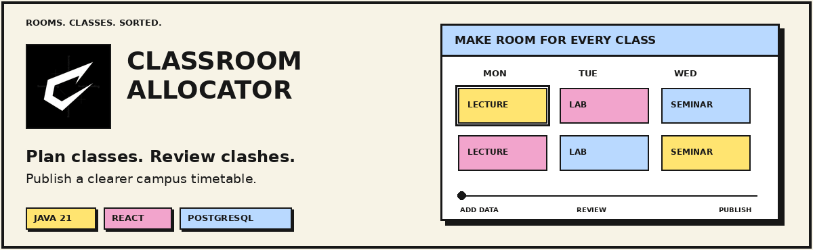
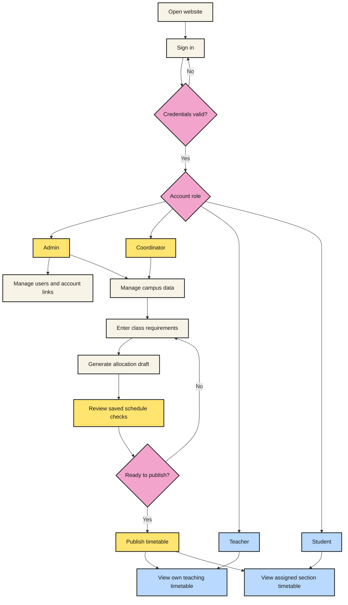

<p align="center">
  
</p>

<h1 align="center">Classroom Allocation System</h1>

<p align="center">
  <strong>Plan classes. Review clashes. Publish timetables.</strong>
</p>

<p align="center">
  
  
  
  
</p>

## User Flow



Teacher and Student timetables require the appropriate account links
and a published schedule.

# Classroom Allocation System

A full-stack application for managing classrooms, academic information,
classroom allocations, and published timetables.

Built as a Java major project with role-based access for Administrators,
Coordinators, Teachers, and Students.

## Technology Stack

| Layer | Technology |
|---|---|
| Frontend | React, TypeScript, Vite |
| Backend | Java 21, Spring Boot |
| Security | Spring Security, session authentication, CSRF protection |
| Database | Neon PostgreSQL |
| Database migrations | Flyway |
| Production email | Brevo HTTPS API |
| Deployment | Docker on Render |

## Features

- Role-based login and protected workspaces
- User account creation by administrators
- Password change and email-based password recovery
- Login rate limiting
- Classroom, teacher, subject, section, and time-slot management
- Teacher account linking and student section assignment
- Class requirements and allocation previews
- Saved allocation drafts and schedule validation
- Timetable publication
- Personal timetables for teachers and students

## Account Roles

| Role | Main responsibilities |
|---|---|
| Admin | Manage institution accounts and campus planning |
| Coordinator | Maintain academic information and prepare allocations |
| Teacher | View their linked teaching profile and published timetable |
| Student | View their assigned section and published timetable |

Permissions are enforced by the backend. Selecting a role card on the
login page does not change an account's assigned permissions.

## Project Structure

```text
classroom_allocation_system_project/
├── backend/          # Spring Boot API, security, and allocation logic
├── frontend/         # React application
├── .dockerignore
├── .gitignore
├── Dockerfile
├── render.yaml
└── README.md
```

## Run Locally

### Requirements

- Java 21
- Node.js 24 and npm
- Access to a Neon PostgreSQL database
- Gmail SMTP credentials for local password-recovery emails

### Backend Configuration

Set these environment variables in the terminal used to start the backend:

| Variable | Description |
|---|---|
| NEON_JDBC_URL | JDBC URL containing the database host, port, and database name |
| NEON_USERNAME | Neon database role |
| NEON_PASSWORD | Database password |
| MAIL_HOST | Local SMTP host, such as smtp.gmail.com |
| MAIL_PORT | SMTP port, such as 587 |
| MAIL_USERNAME | Sender's Gmail address |
| MAIL_PASSWORD | Gmail App Password |
| MAIL_FROM | Sender email address |
| FRONTEND_BASE_URL | Local frontend origin: http://localhost:5173 |

Example JDBC URL:

```text
jdbc:postgresql://YOUR_NEON_HOST:5432/YOUR_DATABASE
```

Keep the username and password in their separate environment variables.

Start the backend from PowerShell:

```powershell
cd backend
.\mvnw.cmd spring-boot:run
```

### Frontend

Open another terminal from the project root:

```powershell
cd frontend
npm ci
npm run dev
```

Open the local URL displayed by Vite.

### Health Check

```text
http://localhost:8080/api/health
```

Expected response:

```json
{"status":"UP"}
```

## Production Deployment

The Dockerfile builds the React frontend and packages it inside the
Spring Boot application. Frontend pages and API requests use the same origin.

The Render Blueprint uses the production profile and requires:

- NEON_JDBC_URL
- NEON_USERNAME
- NEON_PASSWORD
- BREVO_API_KEY
- MAIL_FROM

MAIL_FROM must match a verified sender in Brevo.

Production password-recovery emails use Brevo's HTTPS API.
Local development uses SMTP by default.

Automatic deployment is disabled in render.yaml.
After pushing changes, use Render's Manual Deploy option.

## Security

- Password hashing through Spring Security's configured password encoder
- Backend role-based authorization
- CSRF protection for state-changing requests
- Secure and HttpOnly session cookies in production
- Login rate limiting
- Expiring, single-use password-reset tokens
- Database credentials and email keys supplied through environment variables

Never commit passwords, API keys, or reset links to this repository.

## Verification

Build the frontend:

```powershell
cd frontend
npm run build
```

Run backend tests from a terminal with the required environment configured:

```powershell
cd backend
.\mvnw.cmd test
```

Some integration tests require access to the configured database.
Use a separate test database when running database-backed tests.

## Project Status

The application is under active development.
A successful deployment should be followed by testing login,
role permissions, timetable publication, and password recovery.

---

<p align="center">
  <strong>Designed &amp; Developed by Piyush Barman</strong>
</p>

<p align="center">
  <a href="https://github.com/PIYUSHBARMAN7">GitHub · PIYUSHBARMAN7</a>
</p>